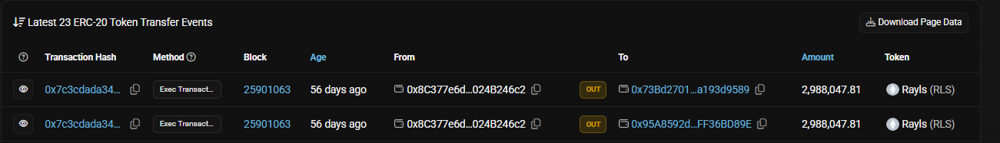
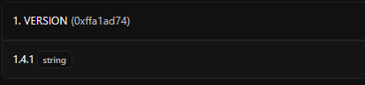
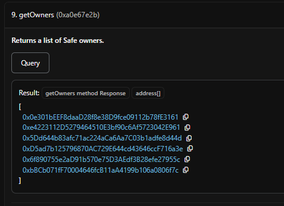
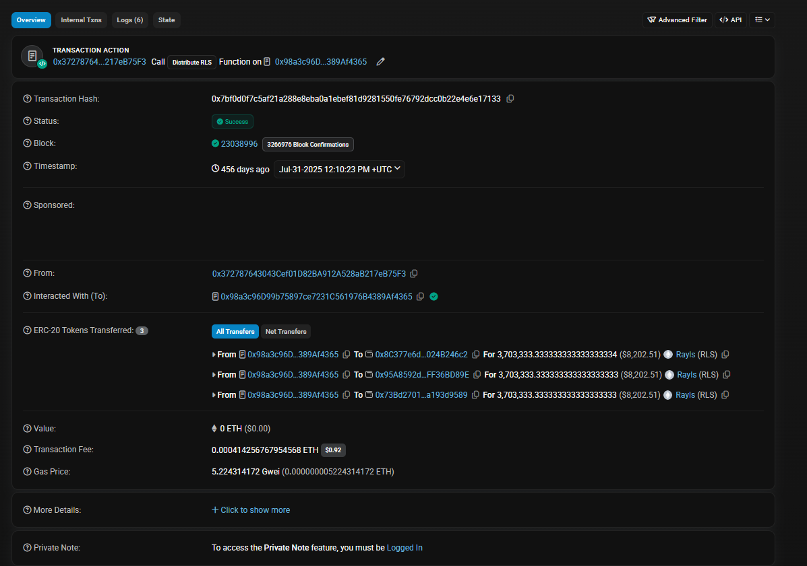
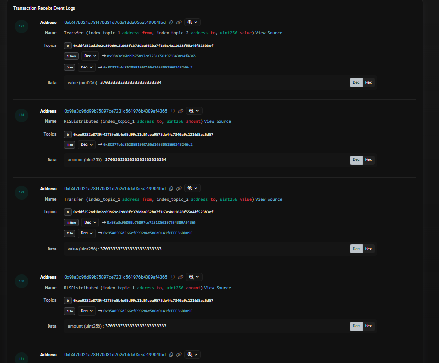
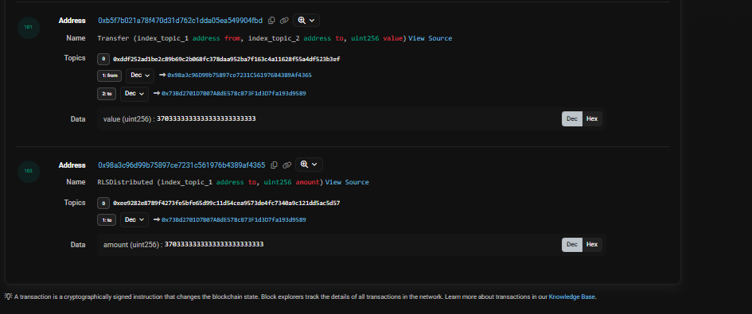

# Can Rayls’ $RLS Token Flows Be Independently Verified Onchain?

Tracing Foundation treasury transfers, examining a Safe multisig, and investigating a contract that distributes RLS to three destinations.

Blockchain transparency is often discussed as if public transactions automatically make an entire financial system verifiable. But there is a difference between seeing tokens move and understanding why they moved, where they came from, and how those movements fit into a project's tokenomics.

I wanted to investigate how much of Rayls’ $RLS token flows could be independently traced using public Ethereum data.

I started with the Foundation treasury, followed repeated transfers to two destination addresses, inspected a multisig wallet, and examined a successful distribution transaction and its event logs.

The result is a clearer picture of several onchain operations, along with some important questions that the available evidence does not yet answer.

## 1. Starting with the Foundation treasury

I began with the Ethereum address listed as the Foundation Treasury Fees Accumulation address:

`0x8C377e6d86285B195CA55d165305156024B246c2`

[View the Foundation treasury on Etherscan](https://etherscan.io/address/0x8C377e6d86285B195CA55d165305156024B246c2)

Its public RLS transfer history provides a starting point for investigating how tokens move between addresses.

One pattern caught my attention: the treasury had sent matching amounts of RLS to two different destinations. For example, both received 2,988,047.81 RLS in block 25,901,063.

The two addresses were:

- `0x73Bd2701D7B07A8dE578cB73F1d3D7fa193d9589`
- `0x95A8592dE66cfE99284e586a9141f6FFF36BD89E`

Matching transfers do not, by themselves, explain the purpose of either wallet. Rather than assign roles based on the amounts, I examined their address information and transaction histories.

## 2. Wallet A: a Safe multisig with six owners

The first destination, `0x73Bd2701D7B07A8dE578cB73F1d3D7fa193d9589`, is identified on Etherscan as a Safe 1.4.1 smart account.

I queried its `getOwners()` and `getThreshold()` functions. The results showed six owners and a transaction confirmation threshold of four.

In practical terms, the Safe is configured to require four owner confirmations to execute a transaction under its normal operating rules.

[View Wallet A on Etherscan](https://etherscan.io/address/0x73Bd2701D7B07A8dE578cB73F1d3D7fa193d9589)

Its token transfer history revealed another significant transaction. At block 25,904,219, the wallet transferred 10,279,714.51 RLS to the conventional zero address, `0x0000000000000000000000000000000000000000`.

A transfer to the zero address is consistent with a burn-related operation. However, the transfer record alone does not establish the exact change in total token supply. I have not independently reconciled the token contract's supply accounting, so I treat this as an observed zero-address transfer rather than a fully verified supply reduction.

The multisig configuration also does not establish the wallet's specific economic role. Its owners and threshold tell us about its transaction authorization structure, not whether it is a burn wallet, treasury account or another operational wallet.

## 3. Wallet B: repeated treasury transfers and distribution activity

The second destination, `0x95A8592dE66cfE99284e586a9141f6FFF36BD89E`, has a longer visible history of incoming RLS transfers.

Several transfers from the Foundation treasury match the amounts sent to Wallet A.

| Block | RLS received from the treasury |
|---:|---:|
| 25,901,063 | 2,988,047.81 |
| 25,588,788 | 2,836,879 |
| 25,424,645 | 2,619,114 |
| 25,137,129 | 5,257,393 |
| 24,937,718 | 8,367,404.77 |

These records show a recurring pattern of treasury transfers. Wallet B's history also contains an outgoing transfer of 5,578,269.85 RLS back to the Foundation treasury at block 24,698,958.

That matters because the observed movements are not exclusively one-way. But without examining the individual transactions and their context, the return transfer does not tell us why the tokens were sent back.

[View Wallet B on Etherscan](https://etherscan.io/address/0x95A8592dE66cfE99284e586a9141f6FFF36BD89E)

The history also includes transactions labelled `Distribute RLS`, originating from a separate contract. That provided a way to move beyond wallet-level patterns and inspect the distribution operation itself.

## 4. Investigating the RLS distribution contract

The contract associated with those distribution transactions is:

`0x98a3c96D99b75897ce7231C561976B4389Af4365`

One particularly useful transaction occurred at block 23,038,996, on July 31, 2025, according to the explorer timestamp.

[View the transaction on Etherscan](https://etherscan.io/tx/0x7bf0d0f7c5af21a288e8eba0a1ebef81d9281550fe76792dcc0b22e4e6e17133)

The transaction was successful. Etherscan identifies the operation as `Distribute RLS`, and the transaction details show three outgoing RLS transfers to the Foundation treasury, Wallet A and Wallet B.

Each recipient received approximately 3.703 million RLS.

| Recipient | RLS transferred |
|---|---:|
| Foundation treasury | 3,703,333.333333333333333334 |
| Wallet B | 3,703,333.333333333333333333 |
| Wallet A | 3,703,333.333333333333333333 |

The amounts differ by one smallest token unit, so they are approximately equal rather than mathematically identical.

This is stronger evidence than simply observing matching amounts in separate wallet histories. The three transfers appear in the same successful transaction, meaning the relationship between the movements can be inspected directly.

## 5. What the event logs reveal

I also inspected the transaction's event logs.

The screenshots show three ERC-20 `Transfer` events emitted by the RLS token contract and three corresponding `RLSDistributed` events emitted by the distribution contract.

For each of the three destinations, the logs record the recipient and an amount consistent with the corresponding token transfer.

This establishes that the transaction did more than produce three coincidentally similar entries in the explorer. The distribution contract emitted a corresponding distribution event for each recipient in the same transaction.

The distinction is important:

- The ERC-20 `Transfer` events record the token movements.
- The `RLSDistributed` events record the distribution contract's reported distribution activity.

Together, these records provide evidence of a three-recipient distribution operation involving approximately 11.11 million RLS in total.

However, event names are not a substitute for understanding the implementation. I have not completed a full review of the distribution contract's code, so I cannot conclusively explain why these three recipients were selected or what economic category the allocation represents.

## 6. How this relates to Rayls tokenomics

Rayls' [Public Chain Tokenomics documentation](https://docs.rayls.com/docs/public-chain-tokenomics) describes a public-chain fee mechanism involving conversion of fees into RLS, with half allocated to validators and half accumulated for burning.

That documentation provides a framework for investigating the transactions, but it does not automatically explain every transfer found in the treasury history.

The transaction I inspected shows a three-way distribution to the Foundation treasury and two other addresses. It does not independently establish that this specific distribution represents the documented validator-and-burn allocation.

To establish that connection, the investigation would need to trace the funds entering the distribution contract, inspect its verified implementation and determine how the recipient addresses are selected. It would also need to connect the observed transfers to the documented fee mechanism rather than infer that connection from the amounts alone.

Rayls also publishes private-chain revenue figures on its [Transparency Dashboard](https://dapp.rayls.com/transparency). When I reviewed the dashboard, it displayed $1,513,065 in private-chain revenue generated and $108,000 in fees passed back to the Foundation.

Those figures are published dashboard values, not calculations independently derived from the transactions in this investigation. Private-chain revenue, Foundation treasury movements and public-chain fee distributions should be treated as distinct flows unless a verifiable accounting trail connects them.

## 7. What has been verified, and what remains open?

The investigation produced several concrete findings.

**Directly observed in the inspected records:**

- The Foundation treasury has a public RLS transfer history.
- Two destination addresses received matching RLS amounts in selected treasury transfers.
- Wallet A is identified as a Safe 1.4.1 smart account configured with six owners and a four-owner threshold.
- Wallet A transferred 10,279,714.51 RLS to the zero address at block 25,904,219.
- A successful `Distribute RLS` transaction at block 23,038,996 sent approximately 3.703 million RLS to each of three destinations.
- The transaction logs contain three token `Transfer` events and three corresponding `RLSDistributed` events.

**Still unresolved:**

- The full operational roles of Wallet A and Wallet B.
- The complete logic governing the distribution contract and how it selects recipients.
- The source and accounting path of all funds entering the distribution contract.
- Whether the observed three-way distribution corresponds to the documented public-chain fee allocation.
- The exact effect of the zero-address transfer on total token supply.
- Whether the dashboard's published revenue figures can be reconciled completely with the inspected onchain records.

These limits matter. A visible transfer is evidence that tokens moved. A verified contract interface and event logs provide additional context. But neither alone proves the economic purpose of an entire tokenomics system.

## Conclusion

Public blockchain data gives us a meaningful starting point for investigating Rayls' $RLS token flows.

By following treasury transfers, examining a Safe multisig and inspecting a successful distribution transaction, I could establish a specific onchain pattern: approximately 11.11 million RLS was distributed across three destinations in one transaction, with corresponding distribution events recorded in the logs.

That is a concrete finding, not a complete audit.

The next level of verification would require tracing the distribution contract's implementation, identifying the purpose of the recipient wallets, following the funds upstream and reconciling burn activity against total-supply changes.

The most useful outcome of this investigation is a more precise set of questions that can be tested against public records. Transparency becomes meaningful when claims can be connected to transactions, contract behaviour and reproducible accounting, while the gaps in that evidence remain clearly identified.

## Methodology

This review examined selected public Etherscan transaction records, token transfer events, wallet activity, Safe configuration details, and Rayls' published tokenomics documentation.

The analysis focused on a limited set of addresses and transactions rather than a complete reconstruction of all RLS flows. Findings reflect the records inspected during the research and should not be interpreted as a comprehensive audit.

The observed transactions were compared with the project's published descriptions, but a complete reconciliation between those transactions and the documented tokenomics mechanism was not established.
### Sources

- [Rayls Transparency Dashboard](https://dapp.rayls.com/transparency)
- [Rayls Public Chain Tokenomics documentation](https://docs.rayls.com/docs/public-chain-tokenomics)
- [Foundation Treasury on Etherscan](https://etherscan.io/address/0x8C377e6d86285B195CA55d165305156024B246c2)
- [Wallet A on Etherscan](https://etherscan.io/address/0x73Bd2701D7B07A8dE578cB73F1d3D7fa193d9589)
- [Wallet B on Etherscan](https://etherscan.io/address/0x95A8592dE66cfE99284e586a9141f6FFF36BD89E)
- [Distribution contract on Etherscan](https://etherscan.io/address/0x98a3c96D99b75897ce7231C561976B4389Af4365)
- [Distribution transaction, block 23,038,996](https://etherscan.io/tx/0x7bf0d0f7c5af21a288e8eba0a1ebef81d9281550fe76792dcc0b22e4e6e17133)

*This is a limited investigation of selected public blockchain records, not a complete audit of Rayls' revenue or tokenomics.*
